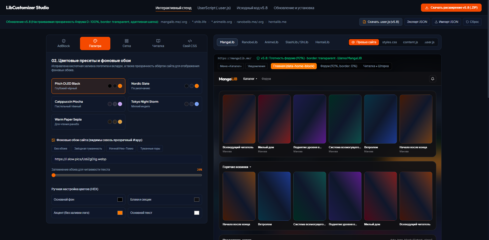
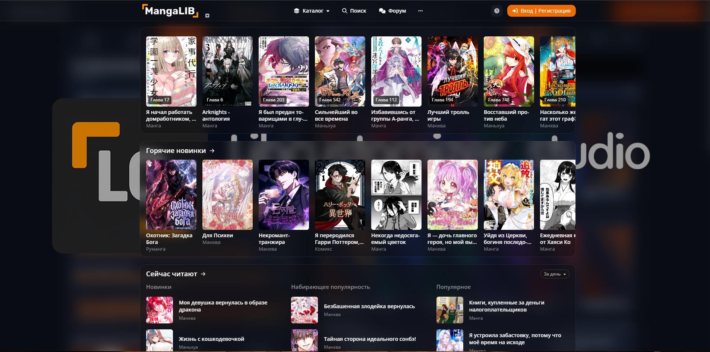

# LibCustomizer studio
**Позволяет редактировать внешний вид сайтов Lib через удобный интерфейс.**

### Результат

*<u>Всё написано ии.</u>*
## Поддерживаемые сайты
- **MangaLib**: `mangalib.me`, `mangalib.org`
- **RanobeLib**: `ranobelib.me`, `ranobelib.org`
- **AnimeLib**: `animelib.org`, `*.animelib.org`
- **SlashLib / ShLib**: `*.shlib.life`, `shlib.life`
- **HentaiLib**: `hentailib.me`
